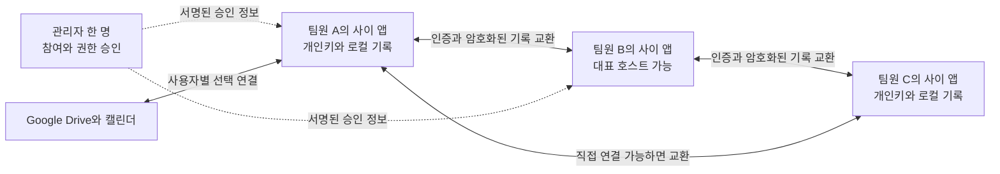

# 사이 앱의 자동 호스트와 PC 간 동기화 설계

> 이전 구조의 기록입니다. 2026-11-17부터 [새 개발 방향](development-direction.md)에 따라 팀 톡·PC 서버·자동 호스트를 제거 대상으로 정했습니다. 아래 내용은 후속 개발 기준이 아니며, 기능 제거가 이미 끝났다는 뜻도 아닙니다.

작성일: 2026년 11월 15일. 상태: 코드 검토를 바탕으로 작성한 구현 전 설계안.

운영 관리자는 한 명으로 유지하고, 팀원이 사이를 실행하면 그 PC가 팀 연결을 도울 수 있게 한다. 여러 팀을 운영하더라도 기본안의 운영 관리자 계정은 하나이며, 프로젝트 작성자·업무 담당자의 일반 권한과 구분한다. 사용자가 선택한 조건은 **외부 조정 서비스 없이 팀 PC만 사용하고, 별도 프로그램 없이 사이 앱만 설치하는 것**이다. Google Drive와 AI 같은 사용자가 연결한 외부 기능은 이 조건과 구분한다.

이 조건에 맞는 권장안은 **각 PC가 자기 기록을 보관하고 연결될 때 교환하는 구조**다. 먼저 실행한 PC는 연결을 중계하는 대표 호스트가 될 수 있지만, 전 세계에서 유일한 쓰기 서버라는 권한은 갖지 않는다. 엄격히 서버 한 대만 쓰는 대안과의 차이는 아래에 명시한다. 이 권장안의 채택과 실제 기능 구현은 별도 단계다.

## 1. 확정한 요구와 설계 선택

| 구분 | 내용 |
|---|---|
| 사용자 요구 | 서버 운영을 관리하는 관리자는 한 명이다. |
| 사용자 요구 | 팀원이 앱을 실행하면 그 PC가 서버 역할을 맡을 수 있다. |
| 사용자 선택 | 호스트 선출을 위한 외부 조정 서비스를 사용하지 않는다. |
| 사용자 선택 | Tailscale 같은 별도 프로그램 설치를 요구하지 않는다. |
| 설계 제안 | 서버 역할에 동의한 PC에 앱 내부의 연결 기능을 실행한다. |
| 설계 제안 | 팀 톡은 PC별 원본 기록을 보관하고, 도착한 기록을 중복 없이 합친다. |
| 설계 제안 | 관리자 권한은 관리자 서명으로 확인하며, 대표 호스트의 변경과 분리한다. |
| 설계 제안 | 같은 네트워크를 먼저 지원하고, 외부 네트워크는 직접 연결 가능한 환경을 구분해 지원한다. |
| 채택 전 결정 | 대표 호스트 방식의 최종 일관성을 허용할지, 단일 서버 방식의 정족수 제한을 택할지 결정한다. |

### 조건에 따라 달라지는 보장

| 상황 | 제공할 수 있는 동작 | 제공할 수 없는 보장 |
|---|---|---|
| 같은 LAN에서 발견·접속이 허용됨 | 자동 발견, 인증, 톡 교환, 대표 호스트 변경 | 게스트 Wi-Fi의 기기 간 차단을 앱만으로 해제 |
| 서로 다른 네트워크에서 주소·방화벽 조건이 맞음 | 등록한 주소로 직접 연결 | 모든 공유기·회사망·통신사 NAT에서 무설정 접속 |
| 한 PC만 켜짐 | 해당 PC에 있는 기록 열람과 새 메시지 저장 | 꺼진 PC에만 있는 기록 조회, 오프라인 수신자에게 즉시 전달 |
| 네트워크가 둘로 나뉨 | 각 연결 집단에서 기록 저장, 재연결 후 합치기 | 양쪽의 즉시 동일한 기록·실시간 강퇴 반영 |
| 모든 PC가 꺼짐 | 다음 실행 때 기기 안의 대기 기록 복구 | 상시 수신, 외부 알림의 계속 발송 |
| 저장 사본을 가진 PC가 모두 손실됨 | 별도로 보관한 백업에서 복원 | 백업 없는 기록과 분실한 복호화 키의 자동 복구 |

같은 LAN의 자동 발견은 로컬 링크에서 동작하는 mDNS를 후보로 한다. 인터넷 전체에서 상대 PC를 찾는 기능과 구분한다. [RFC 6762](https://www.rfc-editor.org/rfc/rfc6762)

외부 서버를 쓰는 ICE/STUN/TURN을 숨겨 넣어 사용자 조건을 충족했다고 설명하지 않는다. ICE는 STUN과 TURN을 사용하는 NAT 통과 기술이다. 이 설계의 기본 모드에서는 해당 외부 서비스를 사용하지 않는다. 직접 연결이 안 되는 환경은 연결 대기로 표시한다. [RFC 8445](https://www.rfc-editor.org/rfc/rfc8445)

## 2. 현재 코드에서 확인한 상태

| 코드 | 현재 동작 | 자동 호스트에 필요한 변경 |
|---|---|---|
| [server/cli.py](../server/cli.py), [server/api.py](../server/api.py) | 별도 Python 서버, 기본 127.0.0.1:8765, Firestore 형태의 HTTP API | 앱 내부의 인증된 PC 연결 기능 추가. 기존 서버를 외부 주소에 그대로 노출하지 않는다. |
| [server/db.py](../server/db.py) | SQLite의 문서·버전·serverId 보관, WAL 사용 | PC마다 독립 원본 로그, 삭제 기록, 동기화 진행 정보 필요 |
| [server/auth.py](../server/auth.py), [core/src/team/backend.rs](../core/src/team/backend.rs) | Firebase 로그인과 토큰 갱신, Google 공개 키로 서버 인증 | 새 PC 모드는 장치 키와 관리자 승인으로 인증. 기존 모드는 별도로 유지 |
| [server/policy.py](../server/policy.py) | 서버에서 팀원별 문서 권한 검사 | 각 수신 PC도 서명과 역할을 검사. 중계 PC의 판단만 신뢰하지 않는다. |
| [core/src/team/shares.rs](../core/src/team/shares.rs) | 팀 톡·파일 링크를 서버에 생성하고 목록을 캐시 | 보낼 때 고정 이벤트 ID 발급, 로컬 영속화 후 재전송, 수신 확인 |
| [core/src/team/delivery.rs](../core/src/team/delivery.rs) | 승인 문안의 대상 확인과 중복 방지 | 수신자 전용 문안은 전달 전 암호화. 기존 문안 ID와 연결 |
| [core/src/team/claude.rs](../core/src/team/claude.rs) | 공용 Claude 키를 팀 integrations 문서에 저장 | 공용 비밀키를 일반 복제 데이터에서 제외 |
| [core/src/notify.rs](../core/src/notify.rs) | Telegram 봇 토큰을 integrations 문서에서 읽음 | 봇 토큰 자동 배포 금지, 외부 발송 담당 중복 실행 방지 필요 |
| [core/src/secret.rs](../core/src/secret.rs) | Windows DPAPI 사용, 실패 시 raw base64 저장 가능 | 새 장치 개인키에는 평문 대체 저장 금지. 보안 저장 실패 시 키 생성 중단 |
| [core/src/store/team_server.rs](../core/src/store/team_server.rs) | serverId별 캐시·대기함 분리, 재시작으로 주소 전환 | 논리적인 팀 ID와 저장소 ID 유지. 대표 PC 변경마다 저장소를 바꾸지 않는다. |
| [core/src/team/account.rs](../core/src/team/account.rs) | Firebase 계정과 팀 목록을 선택적으로 Google Drive에 백업 | 장치마다 별도 신원 사용. Firebase refresh token이나 장치 개인키를 동료 PC에 복제하지 않는다. |
| [src-tauri/src/app.rs](../src-tauri/src/app.rs), [src-tauri/src/ipc.rs](../src-tauri/src/ipc.rs) | 앱 시작·주기적 동기화·화면 요청 처리 | 연결 런타임 수명, 절전 복귀, 팀 전환과 로컬 저장 결과 연결 |
| [ui-app/src/chat/drive.rs](../ui-app/src/chat/drive.rs) | 팀 톡을 주기적으로 조회 | 로컬 기록을 즉시 표시하고 전달 상태와 연결 상태를 별도 표시 |

현재 수신자 전용 문안은 HTTP 권한으로 접근을 제한한다. SQLite 파일 자체를 가진 호스트가 읽지 못하도록 암호화하는 구조는 아니다. 또한 공용 Claude 키와 Telegram 토큰이 들어갈 수 있다. **현재 서버 DB 전체를 임의의 팀원 PC로 복사하는 방식은 채택하지 않는다.**

현재 화면용 캐시는 전체 기록의 완전한 사본이 아니다. 최근 톡 표시 개수 제한도 있으므로, 캐시만으로 새 서버 원본을 만들 수 없다. 현재 서버의 문서 버전 역시 해당 DB의 수정 버전이며, 여러 PC의 합의된 전체 순번이 아니다.

## 3. 대표 호스트와 단일 서버의 차이

| 방식 | PC 한 대만 실행 | 네트워크 분리 | 적합성 |
|---|---|---|---|
| 대표 호스트와 PC별 로그 교환 | 로컬 작성 가능 | 각 집단에서 작성, 이후 합침 | 팀 톡의 권장안. 전역 단일 서버 보장은 없음 |
| 고정된 투표 PC들의 합의로 단일 서버 선출 | 다수결이 안 되면 확정 쓰기 대기 | 다수결을 확보한 쪽만 확정 쓰기 | 엄격한 단일 원본이 우선일 때의 대안 |

예를 들어 투표 PC가 세 대면 두 대가 응답해야 확정할 수 있다. 둘 중 하나만 켜져 있어도 항상 새 서버로 확정하는 정책은 이 안전성과 양립하지 않는다. 투표 대상을 현재 보이는 PC만으로 재계산해서도 안 된다. 정족수 방식의 동작과 장애 허용 관계는 [etcd FAQ](https://etcd.io/docs/v3.6/faq/)를 참고한다. etcd를 사용자 PC에 설치한다는 뜻은 아니다.

권장안에서는 대표 호스트가 중복되어도 서명된 같은 이벤트를 합쳐 동일한 결과로 수렴하게 만든다. 대신 업무 배정처럼 동시에 수정하면 의미가 충돌하는 작업에는 아래의 충돌 규칙을 적용한다. 연결이 끊긴 상태의 전역 단일 호스트 여부를 로컬 화면에서 단정하지 않는다.

## 4. 권장 구성과 실행 흐름

각 앱은 Rust 기반 연결 런타임을 포함한다. 사용자가 Python이나 별도 VPN 프로그램을 설치할 필요가 없도록 한다. 구현 시 TLS·암호화 라이브러리의 Windows x64·ARM64 지원과 설치 파일 포함 방식을 먼저 검증한다.

1. 앱 시작 시 로컬 저장소와 키를 열고, 이전에 받은 기록을 즉시 보여 준다.
2. 서버 역할 동의와 네트워크 설정을 확인한다. 동의하지 않은 PC는 외부 연결을 받지 않고 가능한 상대에게 발신 연결만 한다.
3. 같은 LAN의 서비스 발견과 저장된 피어 주소로 연결을 시도한다. 무차별 IP 스캔을 하지 않는다.
4. 상대의 팀 ID·장치 승인·프로토콜 버전을 확인한다. 발견 패킷만으로 상대를 신뢰하지 않는다.
5. 권한 정보와 로그의 누락 구간을 교환한다. 로컬에 없는 구간은 없다고 숨기지 않고 동기화 대기로 표시한다.
6. 실행 중이며 최근 인증 응답이 확인된 승인 PC가 대표 호스트 후보가 된다. 짧은 탐색 지연 뒤 안정적인 장치 ID 순서로 고르고 살아 있는 대표의 최소 유지 시간을 둔다. PC의 벽시계로 실제 최초 실행자를 판정하지 않는다.
7. 대표 PC가 사라지면 연결된 다른 동의 PC가 중계를 이어받는다. 기록 저장과 메시지 식별자는 대표 PC와 독립적이다.

대표의 우선순위는 연결 가능성, 호스팅 동의, 프로토콜 호환 여부, 연결 집단에서의 안정성을 기준으로 한다. 갱신될 때마다 대표가 바뀌지 않게 유지 시간을 둔다. 후속 [현재 연결 범위의 대표 선정](mesh-automatic-connection.md)은 탐색·안정 2초, 완료 후 응답 재확인 약 5초, 최근 응답 유효 15초, 살아 있는 대표 유지 10초를 사용한다. 호스트 생존 확인 실패를 강퇴나 기록 삭제로 처리하지 않는다.

## 5. PC 연결과 설치 정책

### 같은 네트워크

앱이 관리하는 포트의 TLS 연결과 LAN 서비스 발견을 사용한다. 발견 광고에는 팀 이름·실명·참여 코드·메시지를 싣지 않는다. 불투명한 서비스 식별자와 접속 정보만 노출하고 인증 후 팀 정보를 확인한다. 네트워크에서 앱 사용 사실과 주소가 관찰될 수는 있다.

Windows 방화벽의 앱 통신 허용 요청이 생길 수 있다. 별도 프로그램 설치가 없다는 설명과 운영체제의 통신 허용이 필요할 수 있다는 설명을 구분한다. 기본은 개인 네트워크에서만 수신하고, 공용 네트워크와 외부 직접 접속은 사용자가 설정한 경우에만 허용한다. 관리자 권한 서비스 등록·공유기 UPnP 포트 개방·방화벽 전체 해제는 자동으로 수행하지 않는다.

### 서로 다른 네트워크

이미 알고 있는 도달 가능한 IPv6 또는 사용자가 설정한 직접 접속 주소를 사용한다. 인증서 공개키를 승인 정보와 대조하므로 주소만 알아낸 다른 장치를 신뢰하지 않는다. 주소가 바뀌어도 장치 키를 기준으로 다시 검증한다.

처음 만나는 원격 PC의 주소 전달과 키 확인은 관리자 초대 파일·QR·직접 입력으로 한다. 이메일 등으로 사용자가 직접 전달할 수 있지만 앱의 자동 발견 서비스로 간주하지 않는다. 기존 주소가 모두 낡았으면 새 주소를 다시 전달해야 한다.

통신사 CGNAT, 회사망 차단, IPv6 미지원 등으로 직접 연결이 불가능하면 해당 환경에서는 원격 자동 연결을 보장하지 않는다. 네트워크를 달리해 테스트하기 전에는 원격 지원 완료로 표시하지 않는다. 향후 사용자 선택이 바뀌면 앱 내부 중계 사용 옵션을 별도 설계할 수 있으나, 기본 모드가 몰래 공용 중계를 사용하는 일은 없다.

## 6. 관리자와 장치의 신원

관리자는 팀 권한의 승인자 한 명이며 항상 접속해 있을 필요는 없다. 대표 호스트는 연결 담당일 뿐이다. 일반 팀원 PC가 대표가 되어도 회원 승인·강퇴·권한 변경·팀 해산을 임의로 할 수 없다.

- 팀을 만들 때 관리자 공개키를 팀 신뢰의 기준으로 등록한다. 최초 키 지문은 초대 시 별도 경로로 확인한다.
- 장치는 서명용 키와 암호화용 키를 별도로 생성한다. 새 장치는 요청 파일을 만들고 관리자가 장치 공개키와 사용자 ID의 연결을 서명해 승인한다.
- 초대 파일은 관리자 승인 정보와 연결 정보다. 다른 PC의 개인키·Firebase 로그인 토큰·Google 토큰을 포함하지 않는다.
- 기본 초대는 승인할 장치 공개키에 묶는다. 복사 가능한 공용 참여 코드를 곧바로 회원 인증으로 사용하지 않는다.
- 관리자 변경은 기존 관리자가 서명한 이관 기록으로 처리한다. 일반 사용자 장치 승인과 관리자 서명 장치 지정을 분리한다.
- 관리자 서명은 한 시점에 지정한 장치 하나에서 수행한다. 관리자 PC 여러 대가 오프라인에서 서로 다른 권한 이력을 만들지 않도록 한다.
- 관리자 복구키는 암호화된 오프라인 백업으로 별도 보관한다. 관리자 키를 잃었다고 다음 호스트에게 권한을 자동 부여하지 않는다.

장치 승인은 서명된 순차 권한 이력으로 교환한다. 이미 확인한 더 높은 권한 버전에서 과거 버전으로 돌아가지 않는다. 같은 버전에 상충하는 관리자 서명이 있으면 임의로 최신을 고르지 않고 권한 변경을 중단해 복구 대상으로 표시한다.

**강퇴가 오프라인 PC에 즉시 알려진다는 보장은 없다.** 재연결 시 권한 이력을 먼저 교환하고 폐기된 키의 새 요청을 차단한다. 폐기 전에 작성했다고 주장하는 미확인 기록은 PC 시각만 믿지 않는다. 강퇴 기록에는 장치별 허용 순번과 해당 로그 해시를 함께 서명한다. 그 경계로 검증되지 않는 기록은 격리하고 관리자 확인이 필요한 정책으로 정한다. 이미 전달되거나 복호화된 과거 기록을 원격으로 회수할 수는 없다.

## 7. 원본 기록과 동기화 프로토콜

### 로컬 저장소

새 모드에는 논리적인 `meshTeamId`와 팀별 로컬 SQLite 저장소를 사용한다. `deviceId`나 대표 호스트 주소가 바뀌어도 같은 팀 저장소를 연다. 기존 `teamServer.serverId`와 자동 연결 모드의 팀 ID를 혼용하지 않는다.

| 테이블 제안 | 보관 내용 |
|---|---|
| team_identity | 팀 ID, 관리자 공개키, 프로토콜 버전 |
| membership_events | 승인·폐기·관리자 이관의 서명 이력 |
| events | 이벤트 ID, 작성 장치, 장치 순번, 부모 해시, 암호문 또는 공개 업무 데이터, 서명 |
| outbox | 아직 상대에게 확인받지 못한 로컬 이벤트와 재시도 상태 |
| peer_frontiers | 피어별 연속 수신 순번과 누락 구간 |
| receipts | 상대가 디스크에 저장했음을 나타내는 장치 서명 확인 |
| projections | 화면용 메시지·업무·약속 목록. 원본에서 다시 만들 수 있는 캐시 |
| quarantine | 서명 오류, 동일 순번의 다른 기록, 권한 충돌 등 적용을 보류한 자료 |

장치별 단조 증가 순번과 원본 이벤트·대기함을 같은 트랜잭션에 기록한다. 이벤트 ID와 장치 순번은 재시도할 때 유지한다. 같은 이벤트 ID에 다른 내용이 오거나 같은 장치 순번에 다른 이벤트가 오면 덮어쓰지 않고 격리한다. 백업 복원으로 이전 장치 순번을 재사용할 위험이 있으면 새 장치 키로 다시 등록한다.

SQLite DB 파일을 공유 드라이브나 Google Drive 동기화 폴더에서 여러 PC가 함께 열지 않는다. WAL은 같은 호스트의 공유 메모리를 필요로 한다. 각 PC가 독립 DB를 열고 앱 프로토콜로 기록을 교환한다. [SQLite WAL](https://www.sqlite.org/wal.html)

### 통신 계약 초안

통신은 인증된 TLS 세션 안의 버전 있는 메시지로 제한한다. 웹뷰에는 피어 소켓이나 원격 실행 기능을 노출하지 않는다. 아래 이름과 크기는 구현 시 고정할 계약의 초안이다.

| 메시지 | 목적과 검증 |
|---|---|
| HELLO | 프로토콜·팀 ID·장치 공개키·승인 증명·난수 challenge 확인 |
| MEMBERSHIP | 권한 이력 교환. 관리자 서명과 순차 연결 확인 |
| SUMMARY | 장치별 연속 수신 순번과 누락 구간 알림. 전체가 최신이라는 선언으로 쓰지 않음 |
| REQUEST_EVENTS | 이미 승인된 팀의 특정 누락 구간만 요청 |
| EVENTS | 제한된 개수·크기의 기록 전달. 이벤트별 서명과 권한 확인 |
| RECEIPT | 검증 후 디스크 커밋된 이벤트에 한해 상대 장치가 서명 |
| PEERS | 인증된 연결 후보 안내. URL·주소의 임의 접속이나 외부 포트 스캔으로 확장하지 않음 |

레코드 서명 대상에는 프로토콜 버전, 팀 ID, 이벤트 ID, 장치 순번, 부모 해시, 업무 유형, 권한 버전, 수신 범위와 payload 해시를 포함한다. 바이트 직렬화 규칙을 고정하고 테스트 벡터를 만든다. JSON 객체의 임의 키 순서를 그대로 서명하지 않는다. 장치 ID는 서명 키 지문과 묶고, 다른 팀의 이벤트를 재사용할 수 없게 한다.

요청 한 번에 최대 100개 이벤트·1MiB, 이벤트 64KiB, 장치당 동시 연결·디스크 사용 상한을 초기 후보로 둔다. 본문 읽기 전 길이를 검사하고, 인증 전 상태에서 큰 자료를 받거나 압축 파일을 풀지 않는다. 백오프와 임의 지연을 사용하고 절전 복귀·네트워크 변경 시 재연결한다. 상한은 실제 기기 실험 후 확정한다.

### 저장과 전달의 의미

| 화면 상태 | 의미 |
|---|---|
| 이 PC에 저장됨 | 로컬 트랜잭션 커밋 완료. 상대에게 전달되었다는 뜻은 아님 |
| 연결 대기 | 연결 가능한 승인 장치를 찾는 중 |
| 다른 PC에도 보관됨 | 다른 장치의 디스크 커밋 확인을 받음. 수신자 열람과 구분 |
| 상대 기기에 전달됨 | 지정된 수신 장치의 저장 확인을 받음 |
| 읽음 | 수신자가 읽음 확인을 허용하고 실제 열람한 경우만 표시 |
| 확인 필요 | 권한·업무 충돌로 기록 적용을 보류함 |

디스크 쓰기 실패 시 입력을 지우거나 성공을 표시하지 않는다. 네트워크 ACK만으로 저장 완료를 판정하지 않는다. SQLite의 내구성 설정과 실제 강제 종료 테스트를 포함하며, 디스크 자체 손실까지 보장한다고 설명하지 않는다. 다른 PC 사본이 없는 메시지는 해당 PC를 잃으면 함께 잃을 수 있다.

## 8. 기록 종류별 병합 규칙

| 기록 | 병합과 권한 규칙 |
|---|---|
| 팀 톡 | 고유 이벤트의 추가 집합. 재전송·여러 경로 수신은 한 건으로 표시 |
| 톡 표시 순서 | 인과 관계를 우선하고 논리 시계·장치 ID·순번으로 동률 정렬. PC의 실제 시각은 표시용 |
| 내가 보낸 톡 삭제 | 작성 사용자 권한을 확인한 삭제 이벤트. 원본이 늦게 와도 다시 표시하지 않음 |
| 수신자 전용 승인 문안 | 수신자 장치용 암호문만 교환. 일반 팀 톡으로 변환하지 않음 |
| 팀 약속 응답 | 약속 ID와 사용자별 응답을 구분. 다른 사람의 응답을 대신 쓰지 못함 |
| 업무 수락 | 배정 버전을 참조한 담당자의 서명 필요. 배정 변경과 경합하면 재확인 |
| 업무 배정 변경 | 프로젝트 권한과 기준 버전 확인. 충돌한 두 배정을 임의 시각 비교로 덮어쓰지 않고 선택 요구 |
| 프로젝트·업무 삭제 | 권한 있는 삭제 이벤트가 오래된 수정·스냅샷보다 우선. 존재하지 않는 상위 항목의 수정은 적용 대기 |
| 강퇴·팀 해산 | 관리자 서명 확인, 이전 권한 이력 재전송으로 되살리지 않음 |
| Google 완료 반영 | 원래 작업 ID·수정 기준을 유지하고 같은 변경은 한 번만 적용 |

대표 호스트가 임의로 작성자나 순서를 바꾸지 못하도록 각 PC가 원본 서명을 검사한다. 순번은 해당 장치가 주장하는 인과 순서이며 세계 공통 실시간 순서는 아니다. 서로 모르는 오프라인 기록이 있을 수 있으므로 화면에 전체 최신 상태를 무조건 보장하지 않는다.

삭제 기록은 단순한 물리 삭제와 구분한다. 오래된 PC가 다시 들어올 수 있는 동안 삭제 이력을 보관한다. 기록 압축은 폐기된 장치 목록과 승인된 체크포인트·이벤트 경계를 포함하는 별도 설계와 복구 테스트 후 제공한다. 공간 부족을 이유로 삭제 이력부터 지우지 않는다.

## 9. 암호화와 호스트의 신뢰 범위

수신자 전용 문안은 내용과 내부 작성자 증명을 수신자 장치 키로 암호화한 뒤 전달한다. 보낸 사람이 자기 기록을 다시 열어야 하면 자기 장치용 암호문도 별도로 만든다. 일반 팀 톡도 승인된 수신 장치들의 키에만 전달하도록 구성하고, 새 팀원이 과거 기록을 자동으로 받는지는 권한 정책으로 정한다. 장치 폐기·키 교체를 확인하면 이후 메시지의 수신 키 목록에서 이전 키를 제외한다. 오프라인 장치가 아직 폐기 사실을 모르는 동안의 발송까지 소급 차단하지는 못한다.

표준 암호화 라이브러리를 사용하고 자체 암호 알고리즘은 만들지 않는다. 후보인 libsodium sealed box는 수신자 암호화 기능을 제공하지만 그 자체로 작성자 신원을 인증하지 않는다. 작성자 확인에는 별도 서명 검증이 필요하다. 정확한 라이브러리·키 포맷·수신자 키 교체·정규화 규칙은 보안 프로토타입에서 테스트 벡터와 함께 확정한다. [Sealed boxes](https://libsodium.gitbook.io/doc/public-key_cryptography/sealed_boxes), [Public-key signatures](https://libsodium.gitbook.io/doc/public-key_cryptography/public-key_signatures)

기본 공개키 암호화만으로 키 탈취 이전의 모든 과거 내용이 보호되는 전방향 비밀성을 주장하지 않는다. 새 장치에서 과거 기록 복구는 승인과 암호화된 키 이전 절차를 필요로 한다. 수신자 개인키가 모두 없어지면 관리자도 해당 문안을 복호화할 수 없다.

| 대상 | 호스트 변경 시 정책 |
|---|---|
| 개인 상담 원문·정리 초안 | 작성 PC 내부에 유지. 복제 대상에 포함하지 않음 |
| 승인한 개인 전달 문안 | 지정 수신자에게 암호화. 승인과 수신 범위를 재확인 |
| 장치 개인키·관리자 개인키 | OS 보안 저장소에 유지. 중계 PC로 복제 금지 |
| Firebase·Google refresh token | 개인 계정 정보로 취급. 팀 로그와 분리 |
| 개인 Claude·GPT API 키 | 개인 PC 내부에 유지 |
| 공용 Claude 키·Telegram 봇 토큰 | 일반 로그·스냅샷에서 제외. 새 모드에서는 안전한 별도 설계 전까지 해당 공용 연동을 활성화하지 않음 |
| Google Drive 파일 | 원본은 Google에 보관. 로그는 링크와 메타데이터만 해당 수신 범위로 공유 |

호스트도 일반 팀원으로서 팀 톡을 읽을 수는 있다. 수신자에 포함되지 않은 개인 문안은 읽지 못해야 한다. 암호화해도 접속 주소·시간·암호문 크기·일부 라우팅 식별자는 노출될 수 있으므로, 중계 PC에 대한 발신자 익명성까지 보장하지 않는다. 현재의 이름을 숨기는 화면과 네트워크 수준의 익명성을 구분한다.

Drive 링크를 지우거나 팀원을 강퇴해도 Google 원본의 공유 권한은 별도다. 이미 내려받은 기록·파일의 원격 삭제도 보장하지 않는다. 사용자가 로컬 장치를 장악한 공격자에게 화면에 복호화된 내용까지 숨길 수 있다고 설명하지 않는다.

## 10. 기존 팀의 이전과 복원

1. 기존 서버의 일관된 백업을 만들고 복원 가능성을 확인한다. 동작 중 DB의 파일 복사 대신 SQLite Backup API를 사용한다. [SQLite Backup API](https://sqlite.org/backup.html)
2. 운영 관리자 계정 한 명과 그 계정이 승인하는 팀별 신뢰 기준을 정한다. 기존의 여러 관리자 레코드를 그대로 복제해 새 운영 관리자 권한으로 해석하지 않는다.
3. 각 참여 PC가 장치 키를 만들고 관리자가 사용자·기존 UID·새 장치의 연결을 승인한다. 기존 refresh token은 수집하지 않는다.
4. 이전 구간 동안 기존 공유 쓰기를 잠시 멈추고 기준 버전을 확정한다. 이전 서버와 새 모드에 동시에 쓰지 않는다.
5. 완전한 팀 공개 기록을 가져와 출처와 기준 버전이 있는 초기 체크포인트로 변환한다. 기존 기록에 새 작성자 서명이 있었다고 꾸미지 않고 이전 자료임을 표시한다.
6. 수신자 전용 기존 문안은 일반 팀 스냅샷에서 제외한다. 적법하게 읽을 수 있는 작성자·수신자 기기에서 내용과 대상을 확인하고 새 장치 키로 암호화해 옮긴다. 수신자가 미등록이면 이전 대기로 남긴다.
7. 공용 비밀키·토큰을 스냅샷에서 제거하고 자동 복제 데이터 검사로 확인한다. 기존 시스템에 남은 평문 사본까지 새 암호화로 소급 보호되지는 않는다.
8. 승인된 두 번째 PC에 기록을 보관하고 이벤트 수·내용 해시·삭제 상태·복구를 검증한 뒤 새 팀 모드의 쓰기를 연다. 그전에는 사본이 한 대뿐임을 명시한다.

이전 자료의 신뢰 기준은 관리자가 확인한 기존 서버의 체크포인트다. 임의 팀원 PC의 화면 캐시를 전체 팀 기록의 권위 있는 원본으로 승격하지 않는다. 기존 문서 ID와 새 이벤트 ID의 매핑을 보관해 재시도 때 중복을 만들지 않는다.

되돌릴 때 기존 서버에 자동으로 과거 상태를 덮어쓰지 않는다. 새 모드에 이미 작성한 기록이 있으면 쓰기를 멈추고 내보내기·차이 확인·명시적 복구 절차를 사용한다. 대표 호스트 변경은 이전·복구 작업이 아니며 앱 재시작을 요구하지 않는다.

## 11. 구현 범위와 순서

| 단계 | 구현 내용 | 다음 단계로 넘어갈 조건 |
|---|---|---|
| 0. 연결 실험 | 같은 LAN 두 PC 자동 발견, 상호 인증, x64·ARM64 설치·방화벽·절전 검증, 외부 두 네트워크 직접 접속 조사 | 지원 가능한 네트워크 조건과 실패 안내 확정 |
| 1. 신원과 로그 | 단일 관리자 서명 이력, 장치 등록·폐기, 로컬 SQLite 이벤트·대기함·충돌 격리, 비밀키 보안 저장 | 위조·재전송·강제 종료·저장 실패 테스트 통과 |
| 2. 팀 톡 | 이벤트 교환, 수신자 암호화, 사본 확인, 대표 PC 변경, 삭제 전파, 앱 내부 런타임 | 세 PC의 단절·재접속·대표 종료 후 동일한 공개 기록으로 수렴 |
| 3. 기존 팀 이전 | 초기 체크포인트, UID 매핑, 수신자 전용 문안 암호화, 제외 자료 검사, 복원 | 실제 형태의 이전 자료로 대상별 접근과 기록 수 검증 |
| 4. 업무와 약속 | 유형별 권한·충돌 규칙, 담당자 수락, 배정 버전, 프로젝트 삭제, Google 완료 교환 | 동시 수정·강퇴 경합·중복 Google 반영 테스트 통과 |
| 5. 외부 연동 | 공용 키 배포 대안, Telegram 담당과 발송 중복 방지, 다중 장치 복구·기록 압축 | 비밀키 노출과 외부 중복 실행 위험을 별도로 해결 |

첫 배포에서 팀 톡만 실험한다면 협업·공용 연동까지 분산 전환되었다고 표시하지 않는다. 모드별 지원 범위를 화면에 표시하고, 동일 팀 자료가 두 원본에 나뉘어 쓰이지 않도록 기능을 제한한다.

서버가 두 번 호출해도 중복될 수 있는 Telegram 같은 외부 부작용은 로그 중복 제거만으로 한 번 실행을 보장하지 않는다. 외부 서비스의 멱등성 지원이나 별도 발송 책임 정책을 확정하기 전까지 자동 호스트 인계에 포함하지 않는다.

### 코드 변경 지점 제안

- `core/src/team/mesh/`: 장치 신원, 관리자 서명 권한 이력, 이벤트 검증·병합, 동기화 범위와 상태.
- `core/src/store/`: 팀별 SQLite 로그와 읽기 모델. 현재 서버별 캐시 분리와 별도 경로 사용.
- `src-tauri/src/mesh/`: 앱 내부 TLS listener, 발견·연결, 절전·네트워크 변경, 종료 시 정리.
- `core/src/team/backend.rs`: 기존 Firebase·데스크톱 모드와 구분되는 새 모드. 변경 가능한 문서 API를 무리하게 범용 CRDT로 바꾸지 않고 톡·업무별 어댑터를 둔다.
- `src-tauri/src/ipc.rs`, `ui-app/src/chat/drive.rs`, `ui-app/src/chat/settings/`: 로컬 저장 결과, 연결·전달 상태, 장치 승인·호스팅 동의 표시.
- `server/`: 기존 고정 PC 모드와 이전 도구 유지. 새 모드의 개인키·원본 로그를 기존 REST API로 노출하지 않는다.

새 모드는 팀별로 선택한다. 기존 전체 앱 설정 `teamServer`만으로 서로 다른 팀의 피어 구성을 표현하지 않는다. 특정 팀의 연결 장애가 개인 상담·Google 기능·다른 팀의 로컬 기록 열람을 막지 않도록 런타임과 저장소를 분리한다.

## 12. 필수 검증 시나리오

| 검증 | 합격 기준 |
|---|---|
| 두 PC가 동시에 최초 실행 | 대표 표시가 조정되고 같은 메시지가 한 번만 표시됨. 관리자 권한은 바뀌지 않음 |
| 대표 PC 강제 종료 | 다른 연결 경로로 교환 지속. 대체 PC가 없는 경우 정확히 대기로 표시 |
| 모든 PC 종료 후 과거 PC 하나만 실행 | 로컬 기록만 보여 주고 전체 최신이라고 표시하지 않음 |
| 분리된 두 집단이 각각 톡 작성 | 재연결 후 고유 메시지 집합과 삭제 결과가 동일함 |
| ACK 직전·직후 강제 종료 | 저장 확인한 기록은 재시작 후 존재. 재전송이 중복 메시지를 만들지 않음 |
| 디스크 가득 참·저장 권한 오류 | 성공·전달 완료를 표시하지 않고 입력을 보존 |
| PC 시각 변경 | 권한·삭제·기록 병합이 실제 시각의 앞뒤만으로 뒤집히지 않음 |
| 과거 백업으로 장치 복원 | 순번 재사용을 탐지하거나 새 장치로 등록. 같은 이벤트 ID의 다른 내용 차단 |
| 탈퇴자·위조 호스트·다른 팀의 이벤트 | 권한 검사 실패, 격리, 승인되지 않은 내용과 비밀키 유출 없음 |
| 오래된 권한·오프라인 강퇴 | 낮은 권한 버전으로 복귀하지 않고 경계 밖 자료를 격리 |
| 과거 스냅샷·삭제된 톡 재전송 | 삭제한 내용이 부활하지 않음 |
| 호스트의 DB·전송 기록 검사 | 수신 대상이 아닌 개인 문안의 평문·개인키·Google 토큰·공용 API 키 없음 |
| DPAPI 실패 | 장치 개인키를 raw base64로 대체 저장하지 않음 |
| 게스트 Wi-Fi·회사망·CGNAT·IPv6 유무 | 지원 조건별 성공과 대기 안내를 실제 네트워크에서 확인 |
| 프로토콜 버전 차이 | 호환 불가를 표시하고 기존 기록을 손상시키지 않음 |
| 긴 이력과 대용량 요청 | 정해진 한도 내 메모리·CPU·디스크 사용, 인증 전 큰 요청 거부 |
| Google 로그아웃·인터넷 단절 | PC 간 톡의 로컬 저장과 LAN 교환이 독립적으로 동작 |
| 앱 종료·절전·다중 인스턴스 | 포트·프로세스·장치 순번 충돌을 정리하고 복귀 후 안전하게 재연결 |

단계 0의 [PC 연결 실험](mesh-connection-experiment.md)을 앱 설정에 추가했다. 임시 신원을 가진 루프백 인스턴스와 한 PC의 실제 Wi-Fi에서 발견·상호 TLS 연결을 검증했으며, 실제 두 PC의 설치·방화벽·절전 검증은 배포 전 확인 항목으로 남아 있다. 이 검증을 기다리지 않고 단계 1의 [장기 장치 신원·관리자 승인·DPAPI 키 보관](mesh-identity.md)을 구현했다. 11월 16일 [승인 장치 연결 인증과 로컬 로그·발신 대기함](mesh-local-log.md), [수신자별 암호화·준비 톡 교환·상대 저장 확인](mesh-record-exchange.md), [LAN 자동 발견·재연결·대기 기록 자동 교환](mesh-automatic-connection.md)을 추가하고 검증했다. 이어 작성 PC가 꺼진 뒤 다른 승인 PC가 수신자별 암호문과 최종 확인을 보관·전달하는 기능을 별도 동의로 추가했다. 현재 인증된 연결 범위의 대표 선정·응답 확인·우선 교환·종료 후 재선정과 새 대표를 통한 기록 전달까지 연결했다. 앱 시작·종료·절전 복귀와 같은 Windows 네트워크에 묶인 별도 자동 복구 동의를 추가했다. 기존 공개 톡을 서버에서 새로 조회하고 선택한 내용만 관리자 PC에 보호해 보관하는 경로도 추가했다. 이 사본은 재발송하지 않으며 원본 수정·삭제는 자동 반영되지 않는다. 후속으로 Drive의 별도 PC 톡 화면에 새 작성·조회·작성 장치 서명 삭제·저장 확인·중계를 연결했다. 기존 서버 UID 매핑·원본 쓰기 중단·삭제 상태 확인·전환 시점과 전체 복구 가능한 이전은 남아 있다. 한 PC의 실제 Wi-Fi 검증을 서로 다른 PC의 배포 검증으로 해석하지 않는다.
