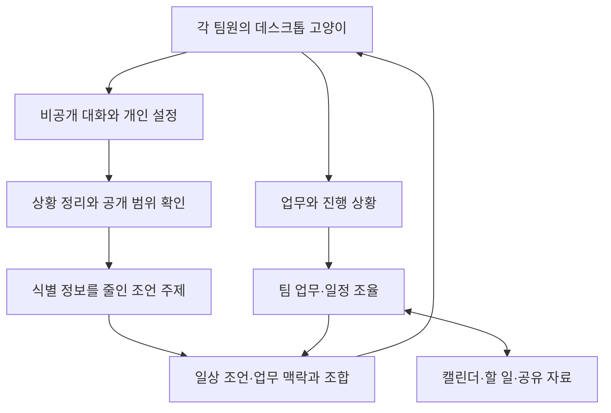

# 데스크톱 고양이 기반 AI 협업 도우미
## 개발 방향 확인서 — GPT가 이해한 사용자의 의도

- 작성일: 2026-11-13
- 상태: 요구사항 확인용 초안
- 작업명: 사이 — 고양이 협업 도우미
- 제품명과 고양이 이름은 임시 명칭이다.
- 아래 내용은 앞으로 만들 제품의 방향이다. 모든 기능이 현재 구현되었다는 의미는 아니다.

---

## 1. 만들고 싶은 프로그램

**각 팀원의 바탕화면을 돌아다니는 고양이가 평소에는 명언과 생활·협업 조언을 건네고, 개인적으로 들은 팀의 고민은 상담과 정리를 거쳐 출처가 드러나지 않는 행동 조언으로 자연스럽게 반영하며, 실제 업무와 일정까지 함께 조율하는 AI 협업 도우미를 만든다.**

사용자는 고양이와 대화하면서 감정을 정리하고, 상대방은 공개적인 비난을 받지 않으면서 자신의 행동을 돌아볼 기회를 얻는다. 이후에는 약속·일정·업무 분배를 실제로 바꿔 같은 갈등이 반복될 가능성을 줄인다.

목표는 **함께 일할 때 생기는 감정적 마찰과 실무상의 혼선을 줄이는 것**이다. 모든 갈등을 없애거나 모든 팀의 성공을 보장한다는 뜻은 아니다.

### GPT가 이해한 핵심 경험

> “내 바탕화면에 고양이가 함께 살면서 평소에도 이런저런 말을 건넨다. 팀원 때문에 속상하면 그 고양이에게 이야기할 수 있다. 고양이는 내 말을 그대로 옮기지 않고 왜 그렇게 느끼는지 들어주고 정리한다. 전달이 허용된 고민은 상대의 고양이가 평소에 해주던 조언 속에 자연스럽게 녹여낸다. 상대도 자기 사정을 이야기할 수 있고, 필요하면 우리 팀의 약속과 업무 분배가 바뀐다. 고양이는 누가 무엇을 언제까지 해야 하는지, 무엇을 준비하고 공유해야 하는지도 함께 챙긴다.”

중요한 세 요소는 **데스크톱 고양이의 지속적인 존재감**, **상담과 일반화를 거친 간접적인 조언**, **실제 업무·일정 조율과의 연결**이다.

## 2. 사용자 요구와 GPT의 설계 제안을 구분

| 구분 | 내용 |
|---|---|
| 사용자가 명확히 원하는 경험 | 데스크톱 펫처럼 고양이가 바탕화면을 돌아다닌다. |
| 사용자가 명확히 원하는 경험 | 고양이가 평소에도 명언과 조언을 먼저 건넨다. |
| 사용자가 명확히 원하는 경험 | 불만을 그대로 전달하지 않고, AI가 상담하고 언어를 정리한다. |
| 사용자가 명확히 원하는 경험 | 정리한 내용을 평소 조언 속에 자연스럽게 섞어, 상대가 특정 팀원의 불만을 전달받는 느낌을 줄인다. |
| 사용자가 명확히 원하는 기능 | PR·역량·가능 시간을 바탕으로 일을 잘게 나누고 공정하게 배정한다. |
| 사용자가 명확히 원하는 기능 | 준비물·정보 공유·진행 확인·마감 전 완료를 도와 협업 전반을 관리한다. |
| 사용자가 허용한 연결 방식 | Google 캘린더·할 일·공유 폴더, Discord·카카오톡·Notion·Telegram 등. 특정 서비스에 고정하지 않는다. |
| GPT의 해석 | 개인별 고양이와 중앙의 팀 조율 기능이 연결된 제품이 적합하다. |
| GPT의 설계 제안 | 개인 대화와 공동 업무 데이터를 분리하고, 일반화된 주제를 사용할 범위에 대해 미리 동의를 받는다. |
| GPT의 설계 제안 | 집중 모드, 말풍선 빈도, 자동 전달 범위, 조언 거절·수정 기능을 제공한다. |
| 아직 결정하지 않은 사항 | 고양이 외형·이름·말투, 자동 조언 허용 범위, 최초 지원 메신저, 세부 기술 스택과 운영 비용. |

**“제안”으로 표시한 사항은 사용자가 이미 승인한 요구사항으로 간주하지 않는다.**

## 3. 제품의 중심: 바탕화면에 함께 있는 고양이

### 3.1 고양이가 주된 접점이다

고양이가 사용자의 일상적인 작업 공간에 머문다. 사용자는 업무 관리 페이지를 매번 열지 않아도 말풍선과 짧은 대화를 통해 필요한 안내를 받는다.

기본적으로 기대하는 동작은 다음과 같다.

- 바탕화면 위를 걷거나 앉고, 쉬거나 잠든다.
- 사용자가 드래그해서 위치를 옮길 수 있다.
- 클릭하면 개인 대화창이 열린다.
- 평소에는 명언·격려·협업 조언을 짧게 건넨다.
- 업무 시간이 다가오거나 일정 조정이 필요하면 상황에 맞게 말을 건넨다.
- 긴 대화, 업무 수정, 자료 확인이 필요할 때 상세 화면을 연다.

**고양이가 웹페이지 안에서만 움직이는 장식으로 끝나면 원하는 데스크톱 펫 경험을 충족하지 못한다.** 실제 데스크톱에서 독립적으로 보이는 경험이 필요하다.

### 3.2 고양이가 건네는 말

| 종류 | 예시 | 역할 |
|---|---|---|
| 일상적인 한마디 | “오늘은 가장 작은 한 가지부터 시작해 볼까요?” | 평소의 자연스러운 교류 |
| 짧은 생각거리 | “작은 약속을 지키는 일부터 팀의 신뢰가 쌓여요.” | 관계와 작업 습관 돌아보기 |
| 개인 업무 안내 | “오늘 가능한 두 시간에는 이 작업부터 해보면 어떨까요?” | 실행 지원 |
| 고민을 반영한 조언 | “약속한 시간이 어려워졌다면 기다리는 사람이 생기기 전에 알려 주세요.” | 행동 돌아보기 |
| 공통 합의 제안 | “각자 생각하는 완료 기준을 한 줄씩 맞춰볼까요?” | 팀의 약속 만들기 |
| 진행 확인 | “예상보다 어려운 부분이 생겼나요? 도움을 요청하거나 범위를 나눌 수 있어요.” | 지연 예방과 지원 |

위 문구는 대화 예시다. 유명인의 실제 발언으로 소개하는 명언에는 확인된 출처를 붙이고, AI가 만든 문장은 자체 조언으로 표시한다.

### 3.3 “계속 조언한다”의 의미

고양이와의 관계가 이어지고, 필요할 때 다시 말을 건네는 지속성을 뜻한다.

**설계 제안:** 사용자가 빈도와 시간을 조절할 수 있게 한다. 회의·발표·전체 화면 작업·집중 시간에는 조용히 있게 하고, 말풍선을 닫거나 나중에 보기로 넘길 수 있어야 한다. 같은 조언을 반복해서 사용자를 압박하지 않는다.

구체적인 발화 간격은 아직 정하지 않는다. 조용한 모드를 선택해도 불이익을 주지 않는다.

## 4. 불만을 조언으로 바꾸는 핵심 흐름

### 4.1 먼저 개인 대화에서 상황을 이해한다

사용자가 화가 난 상태로 말해도 원문을 상대에게 전송하지 않는다. 감정과 사실을 구분하고 무엇이 문제였는지 묻는다.

> 사용자: “시간도 안 지키고 맡은 일도 제대로 안 해서 너무 화나요.”
>
> 고양이: “기다리는 동안 일이 밀려서 답답했겠어요. 어떤 약속이 있었고, 실제로는 어떻게 달라졌는지 알려줄 수 있을까요?”
>
> 사용자: “어제 같이 검토하기로 했는데 연락이 없었어요.”
>
> 고양이: “약속한 시간을 함께 확인한 상태였나요? 상대에게 사정이 있었는지는 아직 듣지 못한 건가요?”
>
> 사용자: “사정은 모르겠고, 미리 알려주기만 했어도 괜찮았을 것 같아요.”
>
> 고양이: “늦어진 것과 함께, 미리 알리지 않아 기다리게 된 점이 특히 힘들었던 거군요.”

사용자가 겪은 불편을 인정하되, 확인되지 않은 추측은 추측으로 남긴다. 상대방의 잘못을 자동으로 확정하거나 사용자의 감정에 무조건 편을 들지 않는다.

### 4.2 감정에서 실행 가능한 주제를 추출한다

| 정리할 항목 | 예시 |
|---|---|
| 사용자가 보고한 사건 | 약속한 검토 시간에 상대가 오지 않았다고 말함 |
| 확인된 공동 기록 | 일정은 등록되어 있지만 상대의 수락 여부는 확인되지 않음 |
| 감정 | 답답함, 무시당한 느낌 |
| 실제 영향 | 다음 작업이 지연됨 |
| 기대·필요 | 일정 변경을 미리 알고 싶음 |
| 가능한 행동 요청 | 지연 예상 시 사전 연락, 새 시간 제안 |
| 추가 확인 사항 | 상대가 약속을 알고 있었는지, 다른 사정이 있었는지 |
| 반영 가능한 일반 주제 | 시간 약속, 사전 연락, 일정 재조정 |

감정과 추측을 확인된 사실로 바꾸지 않는다. 한 사람이 같은 불만을 여러 번 말해도 여러 팀원이 같은 의견을 낸 것처럼 집계하지 않는다.

### 4.3 상대의 고양이가 평소 흐름 속에서 조언한다

전달되는 내용은 원문의 욕설·평가가 아니라 실행 가능한 원칙이다.

> “함께 쓰는 시간에는 서로의 다음 일정도 연결돼 있어요. 약속을 맞추기 어려워졌다면 미리 알려 주세요. 특별한 사정이 있다면 이유와 가능한 새 시간을 함께 전하면 조정하기 쉬워져요.”

필요하면 조금 더 분명하게 말할 수 있다.

> “공유 일정에 수락한 약속은 지키는 것이 기본이에요. 어렵다면 사전 연락과 재조정까지가 약속 관리의 일부예요.”

매번 “팀원이 너 때문에 화났다”는 말을 붙이지 않는다. 실제 기록을 확인하지 않았다면 “당신이 어제 약속을 어겼다”거나 “내가 지각을 발견했다”고 꾸며 말하지도 않는다.

### 4.4 조언받은 사람의 설명도 듣는다

> 상대: “나도 일정이 확정된 줄 몰랐어요.”
>
> 고양이: “서로 확정 여부를 다르게 이해했을 수 있겠네요. 다음부터는 참석 확인을 남기는 방식으로 맞춰볼까요?”

상대의 사정을 들으면 해석을 수정할 수 있어야 한다. 처음 불만을 접수한 사람의 의견만을 정답으로 삼아 상대를 교정하는 구조로 만들지 않는다.

### 4.5 실제 협업 방식에 반영한다

- 일정을 잡을 때 참석 확인을 받는다.
- 변경이 필요하면 사전에 알리는 팀의 약속을 만든다.
- 실제 가능한 시간에 맞춰 일정을 다시 잡는다.
- 작업이 어려웠다면 범위를 나누거나 지원 담당자를 붙인다.
- 완료 기준이 모호했다면 함께 수정한다.

일정 변경과 업무 재배정은 관련자가 확인하고 조정할 수 있게 한다. 개인 상담을 했다는 이유만으로 몰래 업무를 빼앗거나 평가 점수를 낮추지 않는다.

## 5. 평소 조언에 고민을 자연스럽게 섞는 방법

### 5.1 원하는 자연스러움

고양이는 평소에도 시간 관리, 협업, 의사소통, 휴식, 업무 시작 등의 조언을 한다. 팀의 고민이 들어오면 그중 관련 주제의 비중과 표현을 상황에 맞게 조정한다.

일정 관련 어려움이 정리되면 당분간 시간 약속과 사전 연락에 관한 실용적인 조언을 조금 더 중요하게 다룰 수 있다.

혼합 비율과 반복 횟수는 미정이다. “일반 조언 몇 개를 끼우면 익명성이 보장된다”는 식으로 판단하지 않는다.

### 5.2 전달 범위

| 상황 | 전달 방식의 예 |
|---|---|
| 특정 개인이 돌아보면 도움이 되는 주제 | 그 사람의 고양이가 비공개로 조언 |
| 팀 공통 규칙이 필요한 주제 | 팀원들에게 공통 원칙을 제안 |
| 사실관계가 불확실한 갈등 | 추가 설명을 듣고 성급한 교정 조언은 보류 |
| 업무량·난이도 불일치 | 조언과 함께 업무 범위·지원·일정 조정 제안 |
| 상황만으로 쉽게 특정될 내용 | 식별 가능한 세부 내용을 줄이거나 전달 보류 |

### 5.3 출처 보호와 신뢰 — 설계 제안

팀원에게 최초 이용 시 다음 구조를 설명한다.

> “고양이의 조언에는 일반적인 협업 원칙과, 팀원들이 공유를 허용한 고민에서 정리한 일반적인 주제가 반영될 수 있어요. 개인 대화 원문과 발언자 이름은 다른 팀원에게 보여주지 않아요.”

매번 누가 말했는지 밝힐 필요는 없다. 동시에 아무 근거 없이 떠올린 조언인 것처럼 거짓 출처를 만들 필요도 없다.

두 명인 팀에서는 상황만으로 발언자를 추측할 수 있다. 목표는 출처 노출을 줄이는 것이며 완전한 익명성 보장은 아니다.

### 5.4 자동 전달 수준은 미정

선택 가능한 설계안은 다음과 같다.

1. **검토 후 공유:** 일반화된 문안과 전달 범위를 사용자가 확인한다.
2. **허용한 주제만 자동 반영:** 시간 관리·연락 습관 등 미리 동의한 주제는 고양이가 자연스럽게 반영한다.
3. **민감한 내용은 별도 확인:** 특정 사건, 인사 평가, 건강·사생활 등은 자동 반영에서 제외한다.

사용자가 원하는 자연스러운 자동 조언에는 2번의 경험이 중요하다. 구체적인 허용 범위는 사용자 확인 후 정한다. 매번 승인 버튼을 눌러야 한다는 조건을 확정 요구로 추가하지 않는다.

## 6. 상담과 언어 정리가 실제로 해야 하는 일

사용자는 상담심리학·집단심리학·언어심리학 등을 고려한 대화를 원한다. 개발에서는 다음처럼 관찰 가능한 동작으로 구체화한다.

| 관점 | 제품이 수행할 행동 |
|---|---|
| 감정 이해 | 무엇 때문에 힘들었는지 묻고 감정과 공격적인 행동을 구분한다. |
| 상황 확인 | 사건, 상대의 사정, 합의 여부, 사용자의 해석을 나눈다. |
| 언어 정리 | 사람에 대한 모욕을 관찰 가능한 행동과 필요한 변화로 바꾼다. |
| 집단 관계 | 다수의 압박을 만들어내지 않고 양쪽의 설명을 반영한다. |
| 요청 구체화 | “잘해라”를 “완료 기준을 확인하고 막히면 알려 달라”처럼 바꾼다. |
| 후속 확인 | 같은 문제가 이어지는지, 일정·업무 구조를 바꿔야 하는지 확인한다. |

“능력이 없다”를 “당신은 능력이 부족하니 노력하세요”로 바꾸는 것은 충분하지 않다. 작업 난이도, 경험, 설명, 준비 시간, 지원 여부를 확인하고 “처음 맡는 부분은 작은 단위로 진행 상황을 공유하고 도움을 요청해 보자”처럼 정리해야 한다.

심리학적 효과나 치료 효과는 별도 근거 검토 없이 보장하지 않는다. 이 단계에서는 대화 원칙과 협업 행동을 설계한다.

구체적인 위해 의도나 긴급한 위험이 드러나면 평소 조언에 섞는 흐름을 멈추고 안전 확인과 적절한 사람의 도움을 우선한다.

## 7. 업무 분배와 일정 조율

고양이는 협업 갈등을 만드는 실제 업무 조건도 함께 다룬다.

### 7.1 필요한 입력

- 프로젝트 목표, 결과물, 마감일.
- 각 팀원의 자기소개(PR), 할 수 있는 일, 경험, 배우고 싶은 일.
- 본인이 확인하고 수정할 수 있는 역량 정보.
- 주간 투입 가능 시간, 가능한 요일·시간대, 이미 잡힌 일정.
- 작업별 예상 시간, 난이도, 필요한 역량, 선행 작업, 완료 기준.
- 준비물, 참고자료, 공유 폴더, 검토할 사람.
- 분배에 필요한 개인 선호와 제약.

PR은 우선 “자기소개와 역량 설명”으로 이해한다. GitHub Pull Request를 뜻하는 기능으로 확정하지 않는다.

### 7.2 공정한 배분의 의미

같은 개수의 일을 주는 것만으로 공정성을 판단하지 않는다.

- 가용 시간 대비 부담이 지나치지 않은가?
- 필요한 역량과 경험을 고려했는가?
- 어려운 일과 반복적인 일이 특정 사람에게 쏠리지 않는가?
- 학습과 도움을 받는 시간을 고려했는가?
- 앞 작업이 끝나야 시작할 수 있다는 제약을 지켰는가?
- 검토·수정 시간을 남겼는가?
- 당사자가 배정 이유를 이해하고 이의를 제기할 수 있는가?

자기소개만으로 능력을 확정하지 않고 본인 확인과 작업 경험을 통해 수정한다. 배정 이유와 추정의 불확실성을 보여준다.

### 7.3 업무 대화 예시

> “이번 주에는 여섯 시간을 쓸 수 있다고 했죠. 이 작업은 네 시간 정도로 예상해요. 나머지는 검토와 수정에 남겨둘까요?”

> “앞 작업이 아직 끝나지 않았어요. 그동안 참고자료를 준비하거나 다른 작업부터 시작할 수 있어요.”

> “지금 계획대로라면 마감 전에 여유가 부족해요. 범위를 줄이거나 일정과 담당자를 다시 맞춰볼까요?”

지연을 꾸짖기 전에 진행을 막는 이유를 묻는다. 불가능한 일정은 억지로 배정하지 않고 무엇을 바꾸면 가능한지 설명한다.

## 8. 외부 서비스 연결 방향

| 연결 대상 | 원하는 역할 | 확인할 범위 |
|---|---|---|
| Google 캘린더 | 가능 시간·바쁜 시간 확인, 작업·회의 일정 반영 | 개인 일정 제목·내용의 공개 범위 |
| Google 할 일 | 개인 할 일과 배정 업무 연결 | 완료 상태·수정·중복 동기화 기준 |
| Google Drive 등 공유 폴더 | 결과물·참고자료·버전 공유 | 실제 파일 접근 권한 |
| Notion | 요구사항·회의 기록·프로젝트 문서 | 어떤 정보가 기준 기록인지 |
| Discord·Telegram·카카오톡 등 | 바탕화면 밖의 알림·대화 접점 | 최초에는 적합한 서비스 하나부터 검토 |
| 데스크톱 앱 | 고양이·말풍선·개인 대화·작업 안내 | 작업 방해를 줄이는 제어 기능 |

이 표는 원하는 역할이다. 모든 서비스의 현재 API 지원 여부나 연결 완료를 주장하지 않는다. 구현 단계에서 공식 문서·계정 권한·비용을 확인한다.

사용자가 원하지 않는 화면 감시, 키 입력 수집, 사적 메시지 열람을 기본 기능으로 추가하지 않는다.

## 9. 프로그램 구성에 대한 제안

개인 대화와 팀 업무 기록은 저장·접근 권한을 분리한다. 다른 팀원에게 전달하는 경로에는 허용된 일반화된 주제만 통과시키는 구조를 제안한다.

업무 변경·일정 등록·메시지 전송에는 별도 실행 권한과 변경 기록이 필요하다. AI가 제안하는 기능과 외부 서비스를 실제로 변경하는 기능을 구분한다.

### 기존에 논의한 앱에서 중심을 바꿀 부분

| 항목 | 이번에 확인한 방향 |
|---|---|
| 주된 접점 | 바탕화면에 살아 있는 고양이와 말풍선 |
| 대시보드 | 상세 업무·설정·자료를 확인하는 보조 화면 |
| 조언 전달 | 페이지를 열지 않아도 상황에 맞게 고양이가 말을 건다. |
| 개인 대화 | 고양이를 클릭해 편하게 시작한다. |
| 관계 조율 | 평소 조언과 고민에서 추출한 주제를 자연스럽게 연결한다. |
| 실무 처리 | 업무 분배·일정·자료 관리와 연결한다. |

기존 구현의 실제 재사용 범위는 코드 점검 후 정한다. 고양이 그림을 대시보드에 추가하는 것만으로 이번 요구를 충족했다고 판단하지 않는다.

## 10. 개발 순서 제안

| 단계 | 만드는 것 | 확인할 결과 |
|---|---|---|
| 1. 경험 시제품 | 움직이는 고양이, 말풍선, 클릭 대화, 조용한 모드 | 원하는 데스크톱 펫 경험인지 |
| 2. 개인 대화 | 감정 이해, 상황 질문, 언어 정리, 공유 범위 | 공격적인 말을 행동 요청으로 정리하는지 |
| 3. 소규모 팀 연결 | 계정별 고양이, 허용한 주제 반영, 양쪽 설명 수집 | 출처 노출과 일방적 비난을 줄이면서 의미가 전달되는지 |
| 4. 협업 기능 | PR, 업무 분해, 분배, 준비물, 진행 확인 | 대화가 실제 작업과 일정 개선으로 이어지는지 |
| 5. 외부 연결 | 캘린더·할 일·공유 자료, 필요 시 메신저 | 중복·잘못된 공개·동기화 충돌을 처리하는지 |
| 6. 사용성 개선 | 조언 빈도, 말투, 재등장 시점, 마감 전 지원 | 방해나 압박으로 느껴지지 않는지 |

처음 검증할 대상은 고양이가 실제 바탕화면에 존재하는 경험과 조언의 전달 흐름이다. 모든 외부 연결과 기술 스택을 먼저 확정할 필요는 없다.

## 11. 방향을 제대로 구현했는지 확인할 기준

- [ ] 고양이가 일반 작업 중에도 바탕화면에 보이고 움직인다.
- [ ] 클릭해서 개인 대화를 시작할 수 있다.
- [ ] 불만이 없어도 평소에 자연스러운 명언과 조언을 건넨다.
- [ ] 욕설과 비난이 들어와도 상대에게 원문을 전송하지 않는다.
- [ ] 불만의 이유와 사실관계를 묻고 사용자의 해석도 확인한다.
- [ ] 상대의 설명을 듣고 초기 판단을 수정할 수 있다.
- [ ] 조언은 인격 평가 대신 행동과 합의를 제안한다.
- [ ] 허용한 고민 주제가 일상적인 조언 흐름에 반영된다.
- [ ] 출처나 다수의 동의를 꾸며내지 않는다.
- [ ] 원문·이름·특정 사건의 세부 정보가 새지 않는지 점검한다.
- [ ] 사용자가 조언을 줄이거나 거절할 수 있다.
- [ ] PR·역량·시간을 고려해 일을 나누고 이유를 설명한다.
- [ ] 준비물·선행 작업·검토 시간·마감 여유를 고려한다.
- [ ] 진행이 막히면 범위·담당·일정 조정을 제안한다.
- [ ] 여러 팀원이 각자 계정과 고양이로 사용할 수 있다.
- [ ] 외부 연결 상태와 실제 동기화 결과를 정확하게 표시한다.

평가에는 “조언이 부담스러웠는지”, “발언자를 추측할 수 있었는지”, “한쪽 편을 든다고 느꼈는지”도 포함한다. 개인 대화 원문을 무단으로 평가 로그에 모으지 않고 동의한 자료를 사용한다.

## 12. 앞으로 정할 부분

- 고양이 외형·이름·말투·감정 표현.
- 일반화된 고민의 자동 반영 범위와 개별 검토 방식.
- 개인별 조언과 팀 공통 조언을 나누는 기준.
- 개인 대화 보관 기간·삭제·학습 이용 정책.
- 최초 지원 운영체제와 연결 서비스. 사용 환경을 고려하면 Windows부터 시작하는 방안이 합리적인 제안이다.
- AI 제공자·모델·운영 비용과 비용 부담 방식.
- 상담 품질 평가에 관련 전문가가 참여할 범위.

이 항목은 앞으로 결정할 부분이다. 문서의 개발 방향을 확인하기 위해 지금 모두 답해야 하는 질문 목록은 아니다.

---

## 참고 범위

- 사용자의 최초 협업 프로그램 설명과 이번 데스크톱 고양이 설명을 바탕으로 작성했다.
- 사용자 제공 시각적 참고 주제: [데스크톱 펫 Google 검색](https://www.google.com/search?q=%EB%8D%B0%EC%8A%A4%ED%81%AC%ED%86%B1+%ED%8E%AB).
- 검색 결과 페이지는 직접 열리지 않아 개별 이미지나 제품 동작을 분석한 것으로 간주하지 않았다.
- 기술 구현 방식과 심리학적 효과에 관한 별도 조사·검증 보고서는 아니다.

